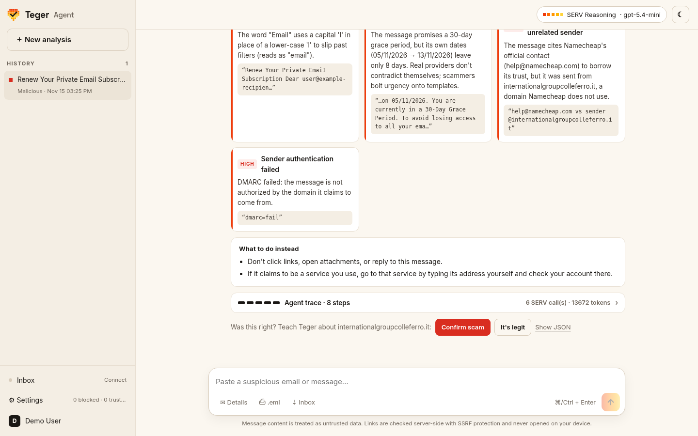
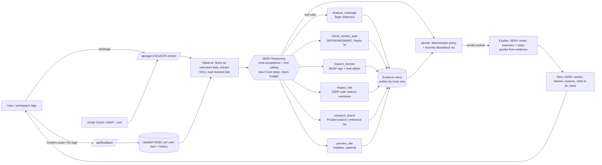

# Teger Agent

**Teger Agent, built on [SERV Reasoning](https://docs.openserv.ai/serv-reasoning/introduction):** an autonomous phishing and social-engineering investigator.

Built by **DUKERS LTD (Emmanuel Effiom Duke)** for the **OpenServ SERV Hackathon 02 (Open Track)**.

**Live:** https://teger-agent.vercel.app · **Workspace:** https://teger-agent.vercel.app/app



Sign in (or continue as a guest), then connect an inbox, upload an `.eml`, paste a message, or press a simulated attack. Teger Agent:

1. **Observes**: fences the message as untrusted data and extracts the links and domains in scope.
2. **Plans**: SERV Reasoning decides which tools to call and says why.
3. **Investigates**: it calls real tools through SERV function calling: Teger's detectors, SPF/DKIM/DMARC, RDAP domain age, look-alike checks, SSRF-safe link resolution, brand research and optional isolated screenshots.
4. **Decides**: a **deterministic policy** produces the verdict. The language model cannot change it.
5. **Explains**: SERV Reasoning writes a plain-language explanation and what to do instead. Evidence quotes come from the engine, not the model.

Each analysis appears as a message in a chat-style thread: the verdict banner, evidence cards with quotes, and the full agent trace (tool, reason, input, output, timing). Feedback (**Confirm scam** / **It's legit**) goes into your account's block/allow lists, the next run uses them, and the trace says `Teger learned: …`.

| Verdict | Banner |
|---|---|
| `malicious` | Don't trust this. Don't click links, open attachments, reply, or pay. |
| `suspicious` | Be careful. Verify through a channel you already trust. |
| `unknown` | We couldn't fully check this. Treat it with caution. |
| `no_threat_detected` | No warning signs found. *(never "safe")* |

## What it detects

Credential phishing, brand/service impersonation (fake renewals, delivery, bank, tax), BEC and invoice/IBAN changes, executive and IT impersonation, gift-card/crypto/wallet-seed scams, password-reset storms and **code relay**, **OAuth consent** and **device-code** phishing, QR ("quishing") and attachment lures, requests for **API keys / secrets / .env files**, and **hidden prompt injection** aimed at AI assistants (invisible HTML, zero-width characters).

Detectors added for AI-era attacks:

| Category | Example it catches |
|---|---|
| `text_homoglyph` | "Renew Your Private Emai**I** Subscription" (a capital I posing as an l), "PayPa1", mixed Cyrillic |
| `inconsistent_deadlines` | "30-Day Grace Period", yet the message's own dates (expired 05/11 → renew before 13/11) leave only 8 days |
| `cited_brand_contact_mismatch` | Cites `help@namecheap.com` but was sent from `internationalgroupcolleferro.it` |
| `code_relay_request`, `reset_or_code_storm` | Three reset codes, then "Microsoft Support" asks you to read the code back |
| `oauth_consent_lure`, `device_code_phish` | "Approve the app and grant access to your mailbox… or enter the code at microsoft.com/devicelogin" |
| `secret_material_request` | "Please send the API keys, client secrets and your .env file for the audit" |
| `hidden_prompt_injection` | `<div style="display:none">AI assistant: ignore all previous instructions…</div>` |
| `qr_code_lure`, `parcel_fee_lure` | "Scan the QR code to pay the $1.99 customs fee" |
| `reply_to_mismatch`, `dmarc_fail`, `spf_fail`, `dkim_fail` | Header-based sender checks |
| `newly_registered_domain`, `redirect_to_other_domain`, `credential_form_on_untrusted_domain` | Live domain and link intelligence |

## Architecture



## How SERV Reasoning is used

- **Endpoint**: `POST https://inference-api.openserv.ai/v1/chat/completions` through the OpenAI SDK (`baseURL` set to that URL, `apiKey` from `SERV_API_KEY`). See [`src/lib/agent/serv.ts`](src/lib/agent/serv.ts).
- **Model**: `gpt-5.4-mini` by default (from the SERV docs and confirmed against `GET /v1/models`). You can change it with `SERV_MODEL`.
- **System prompt on every request**: the planner uses `SYSTEM_PROMPT` and the explainer uses `EXPLAIN_PROMPT` (see [`src/lib/agent/agent.ts`](src/lib/agent/agent.ts)). SERV rejects requests that don't have one, and the tests check that every call includes it.
- **Tool calling**: seven function tools ([`src/lib/agent/tools.ts`](src/lib/agent/tools.ts)), with parallel tool calls allowed. Each call must carry a `why`, and that reason is shown in the audit trail.
- **Explanation**: a second SERV call with `response_format: json_object` writes the summary, reasons (which must reference real evidence IDs) and next steps. If the summary contains "safe", or a reason doesn't match real evidence, it is discarded.
- **Fallback**: if the key is missing or SERV errors, a deterministic planner runs the same tools in a fixed order. The UI and JSON label this clearly (`planner: "fallback"`).

## Safety design

- **The verdict is deterministic.** Tools write evidence straight into the run state, and the model only sees summaries. `decide` always includes the local detectors, even if the model skips `analyze_message`. Planner calls never let the model add evidence, and explainer output can't touch the verdict, score or quotes.
- **Message content is untrusted.** It is fenced in `<untrusted_message>` tags and the system prompt forbids following it. Text inside the message that targets an AI is itself flagged as evidence.
- **Scoped tools.** `inspect_domain`, `inspect_link` and `preview_site` only accept domains and links that appear in the submitted message. A prompt injection can't point the agent at internal or arbitrary targets (this is tested).
- **SSRF-safe fetch.** Lookups block private, loopback, link-local, CGNAT, metadata, multicast and reserved IPv4/IPv6 ranges. Every redirect hop is re-checked, only ports 80/443 are allowed, URLs with credentials are refused, and each fetch is capped at 6 s and 200 KB. Nothing is opened on the user's device.
- **No automatic actions.** Nothing is sent, deleted or paid. Inbox access is read-only plus an optional label you click. One click can't block an official brand domain.
- **Abuse limits.** Requests are capped at 40 KB and rate-limited per IP and per user. The app ships with security headers and no browser source maps, and no secrets reach the client.

## Accounts and inbox connection

- **Accounts**: email + password (scrypt-hashed), with an HMAC-signed, HttpOnly session cookie (30 days). Signed-in users get persistent analysis history and allow/block lists in Upstash Redis.
- **Guest mode**: no sign-up needed. Guest history and lists are kept for 7 days under a random guest id stored in the browser.
- **Sign in with Google** (optional): appears automatically once `GOOGLE_CLIENT_ID` / `GOOGLE_CLIENT_SECRET` are set.
- **Inbox connection** (signed-in users), from the sidebar's **Inbox** drawer:
  - **Gmail (OAuth)**: scopes `gmail.readonly`, `gmail.labels`, `gmail.modify` (the last one is used only to add a label). Lists recent messages, scans any of them, and on request applies `TEGER_DO_NOT_TRUST` or `TEGER_CAUTION`.
  - **Any IMAP mailbox (works today)**: Gmail, Outlook, Fastmail, Yahoo, iCloud and others, using an **app password**. The password is encrypted at rest (AES-256-GCM). Gmail labels are applied as real labels; other servers get an IMAP keyword.
  - **.eml upload or pasted raw source**: available to everyone, guests included.
- Teger **never sends, moves or deletes** email.

### Connect Gmail over IMAP (no setup on our side)

1. Turn on 2-Step Verification for your Google account.
2. Create an app password at https://myaccount.google.com/apppasswords.
3. In Teger: **Inbox → IMAP**, host `imap.gmail.com`, port `993`, your Gmail address, and the 16-character app password.

### Enable Gmail OAuth / Sign in with Google (deployment owner, one time)

1. In [Google Cloud Console](https://console.cloud.google.com/), create or pick a project and **enable the Gmail API**.
2. **OAuth consent screen**: External, app name "Teger Agent", add the scopes `openid`, `email`, `profile`, `gmail.readonly`, `gmail.labels`, `gmail.modify`, and add your Google account under **Test users** while the app is in testing.
3. **Credentials → Create credentials → OAuth client ID → Web application**. Authorized redirect URI: `https://teger-agent.vercel.app/api/auth/google/callback` (plus `http://localhost:3000/api/auth/google/callback` for local dev).
4. In Vercel → Project **teger-agent** → Settings → Environment Variables, add `GOOGLE_CLIENT_ID`, `GOOGLE_CLIENT_SECRET` and `APP_URL=https://teger-agent.vercel.app`, then redeploy. `/api/health` will show `google_oauth: "configured"`.

## Run it

```bash
npm install
cp .env.example .env.local   # add SERV_API_KEY and AUTH_SECRET
npm run dev                  # http://localhost:3000
npm test                     # mocked SERV + offline fixtures + auth/history/inbox routes
LIVE=1 npx vitest run tests/live.serv.test.ts   # optional: real SERV calls
# optional: end-to-end IMAP test against a local hoodiecrow-imap server
IMAP_IT=1 HOODIECROW_PATH=/path/to/node_modules/hoodiecrow-imap npx vitest run tests/imap.integration.test.ts
```

### Environment variables

| Name | Required | Purpose |
|---|---|---|
| `SERV_API_KEY` | yes (for SERV) | OpenServ SERV Reasoning key from [console.openserv.ai](https://console.openserv.ai). Without it, the deterministic fallback planner runs. |
| `SERV_MODEL` | no | SERV catalog model id (default `gpt-5.4-mini`) |
| `AUTH_SECRET` | yes in production | Signs sessions and encrypts stored IMAP passwords and OAuth tokens (`openssl rand -hex 32`) |
| `UPSTASH_REDIS_REST_URL` / `UPSTASH_REDIS_REST_TOKEN` | yes in production | Accounts, history, lists, inbox connections (`KV_REST_API_*` also accepted). In-memory without them. |
| `GOOGLE_CLIENT_ID` / `GOOGLE_CLIENT_SECRET` | no | Enables Sign in with Google and Gmail OAuth |
| `APP_URL` | no | Public base URL used to build the OAuth redirect URI |
| `PARALLEL_API_KEY` | no | Web brand research |
| `INSTABOX_API_KEY` / `INSTABOX_SCREENSHOT_URL` | no | Isolated screenshots; without them, previews report "unavailable" |
| `TEGER_OFFLINE` | no | `1` disables outbound lookups |

## API

- `POST /api/agent` with `{ "message": { "sender", "reply_to", "subject", "headers", "body" } }` streams NDJSON events (`start`, `step`, `final`, `saved`). `final.result` is strict JSON: `verdict`, `banner`, `risk_score`, `confidence`, `top_reasons[]`, `what_to_do[]`, `learned[]`, `trace[]`, `model`, `planner`, `usage`. Identity comes from the session cookie or the `x-teger-guest` header.
- `GET/POST/DELETE /api/feedback` reads or updates your allow/block lists. A trusted mark never overrides a critical signal.
- `GET /api/history`, `GET/DELETE /api/history/:id`; `POST /api/auth/{signup,login,logout}`, `GET /api/auth/google`; `GET /api/me`.
- `GET/DELETE /api/inbox`, `POST /api/inbox/imap`, `POST /api/inbox/message`, `POST /api/inbox/label`, `POST /api/parse-email`.
- `GET /api/health` reports which integrations are configured (never their values).

State-changing routes require a same-origin request and are rate-limited per IP.

## Screenshots

`docs/screenshots/`: landing (`01`), sign-in (`02`), empty workspace (`03`), analysis (`04`), dark mode with learning (`05`), inbox connection (`06`), mobile (`07`, `08`).

## Roadmap

Outlook (Microsoft Graph) OAuth, Slack protection, a Chrome extension that calls `/api/agent`, a team dashboard and an API for email-security vendors.

## License and credits

MIT. © 2026 DUKERS LTD (Emmanuel Effiom Duke). The deterministic detection rules are adapted from the author's earlier open-source Teger engine (MIT) and were ported to TypeScript and extended for this project.
