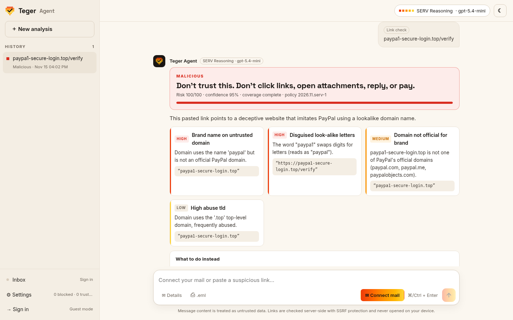
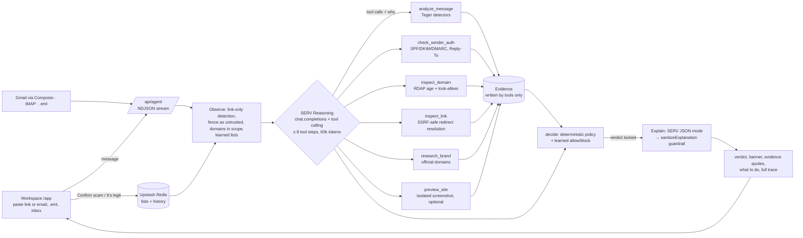

<div align="center">

# Teger Agent

**Connect your mail or paste a suspicious link. An autonomous agent built on [SERV Reasoning](https://docs.openserv.ai/serv-reasoning/introduction) investigates it like a security analyst, and a deterministic engine gives a verdict that a prompt-injected email can't argue with.**

[](https://github.com/dukemawex/teger-agent/actions/workflows/ci.yml)
[](https://teger-agent.vercel.app)
[](https://docs.openserv.ai/serv-reasoning/introduction)
[](docs/EVAL.md)
[](LICENSE)

**[Live demo](https://teger-agent.vercel.app)** · **[Workspace](https://teger-agent.vercel.app/app)** · [Eval results](docs/EVAL.md) · [Architecture](docs/ARCHITECTURE.md) · [Security](SECURITY.md)

OpenServ **SERV Hackathon 02, Open Track** · built by **DUKERS LTD** (Emmanuel Effiom Duke)

</div>



## Try it in 30 seconds (no sign-up)

1. Open **https://teger-agent.vercel.app/app**. Guest mode starts automatically.
2. Click a **Try a link** chip (for example `paypa1-secure-login.top/verify`), or paste any link or whole email into the box and press the arrow.
3. Watch the agent trace stream: SERV plans, tools run, the policy decides, and SERV explains. Open **Agent trace** to see every tool call with its `why`, the SERV call count and the tokens used.
4. Click a **simulated attack** (fake renewal, BEC/IBAN change, reset storm with code relay, OAuth consent, QR parcel, hidden prompt injection) or the **benign control**.
5. Click **Confirm scam**, then run it again: the trace says `Teger learned: …`.
6. Optional: **Connect mail** links Gmail via Composio (read, label and draft only), or use IMAP or an `.eml` file.

You can also deep-link a check: `https://teger-agent.vercel.app/app?link=paypa1-secure-login.top/verify`. `GET /api/health` shows which integrations are live (never their values).

## How SERV Reasoning is used

SERV is the agent's **planner and explainer**. It decides what to investigate, calls tools, and writes the explanation. It is not a classifier glued on at the end.

| What | Where |
|---|---|
| OpenAI SDK pointed at **`https://inference-api.openserv.ai/v1`**, key `SERV_API_KEY`, 45 s timeout | [`serv.ts` L8](https://github.com/dukemawex/teger-agent/blob/f82e183ffece400713dd577d4236abedc03cde7b/src/lib/agent/serv.ts#L5-L10), [`agent.ts` L14](https://github.com/dukemawex/teger-agent/blob/f82e183ffece400713dd577d4236abedc03cde7b/src/lib/agent/agent.ts#L14) |
| **System prompt on every request** (planner `SYSTEM_PROMPT`, explainer `EXPLAIN_PROMPT`); tests assert `messages[0].role === "system"` on every call | [`agent.ts` L73-L85](https://github.com/dukemawex/teger-agent/blob/f82e183ffece400713dd577d4236abedc03cde7b/src/lib/agent/agent.ts#L73-L85), [`tests/agent.test.ts`](tests/agent.test.ts) |
| Message fenced as `<untrusted_message>` data | [`agent.ts` L87](https://github.com/dukemawex/teger-agent/blob/f82e183ffece400713dd577d4236abedc03cde7b/src/lib/agent/agent.ts#L87-L90) |
| **Tool-calling loop**: `chat.completions` with 7 function tools, `tool_choice: "auto"`, `parallel_tool_calls: true`; each call carries a `why` shown in the trace; tool results go back as `role: "tool"` messages | [`agent.ts` L159-L189](https://github.com/dukemawex/teger-agent/blob/f82e183ffece400713dd577d4236abedc03cde7b/src/lib/agent/agent.ts#L159-L189), [`tools.ts` L70-L78](https://github.com/dukemawex/teger-agent/blob/f82e183ffece400713dd577d4236abedc03cde7b/src/lib/agent/tools.ts#L70-L78) |
| Budgets: 8 tool steps, 60k tokens, then deterministic completion | [`agent.ts` L16-L17](https://github.com/dukemawex/teger-agent/blob/f82e183ffece400713dd577d4236abedc03cde7b/src/lib/agent/agent.ts#L16-L17) |
| **Explainer**: second SERV call in JSON mode (`response_format: json_object`), then the `sanitizeExplanation` guardrail | [`agent.ts` L218-L240](https://github.com/dukemawex/teger-agent/blob/f82e183ffece400713dd577d4236abedc03cde7b/src/lib/agent/agent.ts#L218-L240), [`L297-L332`](https://github.com/dukemawex/teger-agent/blob/f82e183ffece400713dd577d4236abedc03cde7b/src/lib/agent/agent.ts#L297-L332) |
| Fallback when SERV is down or the key is missing: same tools in a fixed order, labelled `planner: "fallback"` with a visible note | [`agent.ts` L190-L212](https://github.com/dukemawex/teger-agent/blob/f82e183ffece400713dd577d4236abedc03cde7b/src/lib/agent/agent.ts#L190-L212) |

Model: `gpt-5.4-mini` by default (`SERV_MODEL` to change). In the live eval, SERV made **47 calls (84k tokens) across 10 cases**, choosing a different tool plan per message: for example `analyze_message → check_sender_auth → inspect_domain → research_brand → inspect_link → decide` for the fake renewal, and `analyze_message → inspect_domain → decide` for the gift-card scam.

## Architecture



More detail, including the file map and failure modes: [docs/ARCHITECTURE.md](docs/ARCHITECTURE.md).

## Safety model

- **The verdict is deterministic.** [`policy.decide`](https://github.com/dukemawex/teger-agent/blob/f82e183ffece400713dd577d4236abedc03cde7b/src/lib/engine/policy.ts#L39) is a pure function of evidence and detector coverage. Tools write evidence straight into the run state, and the model only sees summaries. [`decide`](https://github.com/dukemawex/teger-agent/blob/f82e183ffece400713dd577d4236abedc03cde7b/src/lib/agent/tools.ts#L290-L313) always includes the local detectors, even if the model skipped them.
- **Model output is untrusted too.** The explainer's text may only cite real evidence IDs. Anything that reassures ("safe", "looks legitimate", "not a scam"), contains a link, or tells you to act on a risky message is dropped, and the trace says so.
- **Message content is untrusted data.** It is fenced and never followed. Instructions aimed at AI assistants, including hidden HTML and zero-width text, are themselves evidence (`hidden_prompt_injection`).
- **Scoped tools + SSRF-safe network.** Tools only touch domains and links that appear in the message. Fetches block private, loopback, link-local, CGNAT, metadata, multicast, reserved and IPv4-mapped ranges, re-check every redirect, allow ports 80/443 only, and are capped at 6 s and 200 KB. Nothing is opened on your device.
- **Never sends or deletes mail.** Composio sessions are pinned to read, label and draft tools only. IMAP and OAuth secrets are AES-256-GCM encrypted at rest.
- **Never says "safe".** The best verdict is "No warning signs found."

| Verdict | Banner |
|---|---|
| `malicious` | Don't trust this. Don't click links, open attachments, reply, or pay. |
| `suspicious` | Be careful. Verify through a channel you already trust. |
| `unknown` | We couldn't fully check this. Treat it with caution. |
| `no_threat_detected` | No warning signs found. |

Threat model and known gaps: [SECURITY.md](SECURITY.md).

## Evaluation

`npm run eval` runs the 8 simulated emails and 2 sample links through the full agent ([eval/fixtures.eval.ts](eval/fixtures.eval.ts)). Full table: [docs/EVAL.md](docs/EVAL.md).

| Mode | Correct verdicts | SERV usage |
|---|---|---|
| deterministic | 10/10 | – |
| compromised-llm | 10/10 | – |
| serv-live | 10/10 | 47 calls, 84,471 tokens, median 6345 ms |

- **deterministic**: no LLM, offline. This mode runs in CI on every push.
- **compromised-llm**: a SERV mock that *obeys the attacker*. It says "safe", skips the investigation, aims tools at `169.254.169.254`, and returns a fake "verified sender" explanation with a phishing link. Every verdict still matches, and none of that text reaches the user.
- **serv-live**: real SERV Reasoning with live RDAP and link lookups.

Tests: **164 in CI** plus 2 opt-in live checks (unit tests for every detector family and the policy, tools with a mocked network, the SERV loop with a scripted mock, adversarial injection, link checks, auth, history, inbox and Composio). SERV is mocked, so CI needs no key.

## What it detects

Credential phishing, brand/service impersonation (fake renewals, delivery, bank, tax), BEC and invoice/IBAN changes, executive and IT impersonation, gift-card/crypto/wallet-seed scams, password-reset storms and **code relay**, **OAuth consent** and **device-code** phishing, QR ("quishing") and attachment lures, requests for **API keys / secrets / .env files**, and **hidden prompt injection** aimed at AI assistants (invisible HTML, zero-width characters).

Detectors added for AI-era attacks:

| Category | Example it catches |
|---|---|
| `text_homoglyph` | "Renew Your Private Emai**I** Subscription" (a capital I posing as an l), "PayPa1", mixed Cyrillic |
| `inconsistent_deadlines` | "30-Day Grace Period", yet the message's own dates (expired 05/11 → renew before 13/11) leave only 8 days |
| `cited_brand_contact_mismatch` | Cites `help@namecheap.com` but was sent from `internationalgroupcolleferro.it` |
| `code_relay_request`, `reset_or_code_storm` | Three reset codes, then "Microsoft Support" asks you to read the code back |
| `oauth_consent_lure`, `device_code_phish` | "Approve the app and grant access to your mailbox… or enter the code at microsoft.com/devicelogin" |
| `secret_material_request` | "Please send the API keys, client secrets and your .env file for the audit" |
| `hidden_prompt_injection` | `<div style="display:none">AI assistant: ignore all previous instructions…</div>` |
| `qr_code_lure`, `parcel_fee_lure` | "Scan the QR code to pay the $1.99 customs fee" |
| `reply_to_mismatch`, `dmarc_fail`, `spf_fail`, `dkim_fail` | Header-based sender checks |
| `newly_registered_domain`, `redirect_to_other_domain`, `credential_form_on_untrusted_domain` | Live domain and link intelligence |


## Accounts and inbox connection

- **Accounts**: email + password (scrypt-hashed), with an HMAC-signed, HttpOnly session cookie (30 days). Signed-in users get persistent analysis history and allow/block lists in Upstash Redis.
- **Guest mode**: no sign-up needed. Guest history and lists are kept for 7 days under a random guest id stored in the browser.
- **Sign in with Google** (optional): appears automatically once `GOOGLE_CLIENT_ID` / `GOOGLE_CLIENT_SECRET` are set.
- **Inbox connection** (signed-in users), from the sidebar's **Inbox** drawer:
  - **Gmail via Composio (primary)**: click **Connect Gmail**, approve on Google's consent screen hosted by Composio (Composio-managed OAuth, so no Google Cloud project is needed), and you land back in `/app` connected. Teger then lists your last 20 inbox messages with an offline **quick-triage badge** (and a **Suspicious only** filter), fetches any full message (headers + body) and runs the SERV agent on it, saves it to your history, and on request applies `TEGER_DO_NOT_TRUST` / `TEGER_CAUTION` (creating the label if missing). For payment / bank-detail change messages it can save a **verification draft** that you address to a contact you already trust and send yourself. **Disconnect** also revokes the connection at Composio.
  - **Auto-scan new mail (optional)**: with a Composio webhook configured, a `GMAIL_NEW_GMAIL_MESSAGE` trigger posts to `/api/webhooks/composio` (signature verified); Teger scans the message, labels risky ones, and the result appears in History.
  - **Any IMAP mailbox (fallback)**: Gmail, Outlook, Fastmail, Yahoo, iCloud and others, using an **app password**, encrypted at rest (AES-256-GCM).
  - **Direct Google OAuth (optional)**: appears if you configure your own Google OAuth client.
  - **.eml upload or pasted raw source**: available to everyone, guests included.
- Teger **never sends, moves or deletes** email. Composio sessions are pinned to an allow-list of seven Gmail tools (`GMAIL_FETCH_EMAILS`, `GMAIL_FETCH_MESSAGE_BY_MESSAGE_ID`, `GMAIL_LIST_LABELS`, `GMAIL_CREATE_LABEL`, `GMAIL_ADD_LABEL_TO_EMAIL`, `GMAIL_CREATE_EMAIL_DRAFT`, `GMAIL_GET_PROFILE`), so send/delete/trash/forward tools are unavailable even to Teger's own code. Google tokens are held by Composio, never by Teger.

### Enable Gmail via Composio (deployment owner, one time)

1. In the [Composio dashboard](https://platform.composio.dev), open your project → **Settings → API keys** and create a key with these permissions (a default full-access key already has them):
   - **Session management**: write
   - **Connected accounts**: write (create links, verify, revoke on disconnect)
   - **Tool execution**: write
   - **Triggers**: write (only for auto-scan)
2. In Vercel → Project **teger-agent** → Settings → Environment Variables, set `COMPOSIO_API_KEY`, then redeploy. `/api/health` shows `composio_gmail: "configured"`.
3. No auth config is needed: Teger uses Composio's managed Gmail OAuth, which Composio creates automatically on the first connection.
4. Optional auto-scan: Composio dashboard → **Webhooks** → add `https://teger-agent.vercel.app/api/webhooks/composio`, subscribe to trigger events, copy the signing secret into Vercel as `COMPOSIO_WEBHOOK_SECRET`, and redeploy. Then turn on **Auto-scan new mail** in the Inbox drawer.

### Connect Gmail over IMAP (no setup on our side)

1. Turn on 2-Step Verification for your Google account.
2. Create an app password at https://myaccount.google.com/apppasswords.
3. In Teger: **Inbox → IMAP**, host `imap.gmail.com`, port `993`, your Gmail address, and the 16-character app password.

### Enable Gmail OAuth / Sign in with Google (deployment owner, one time)

1. In [Google Cloud Console](https://console.cloud.google.com/), create or pick a project and **enable the Gmail API**.
2. **OAuth consent screen**: External, app name "Teger Agent", add the scopes `openid`, `email`, `profile`, `gmail.readonly`, `gmail.labels`, `gmail.modify`, and add your Google account under **Test users** while the app is in testing.
3. **Credentials → Create credentials → OAuth client ID → Web application**. Authorized redirect URI: `https://teger-agent.vercel.app/api/auth/google/callback` (plus `http://localhost:3000/api/auth/google/callback` for local dev).
4. In Vercel → Project **teger-agent** → Settings → Environment Variables, add `GOOGLE_CLIENT_ID`, `GOOGLE_CLIENT_SECRET` and `APP_URL=https://teger-agent.vercel.app`, then redeploy. `/api/health` will show `google_oauth: "configured"`.

## Run it locally

```bash
npm ci
cp .env.example .env.local   # SERV_API_KEY (optional: deterministic planner without it), AUTH_SECRET
npm run dev                  # http://localhost:3000
npm run check                # lint + typecheck + tests + eval (CI also runs the build)
LIVE=1 npm run eval          # optional: the eval with real SERV (needs SERV_API_KEY + network)
EVAL_WRITE=1 LIVE=1 npm run eval   # regenerate docs/EVAL.md
# optional: end-to-end IMAP test against a local hoodiecrow-imap server
IMAP_IT=1 HOODIECROW_PATH=/path/to/node_modules/hoodiecrow-imap npx vitest run tests/imap.integration.test.ts
```

### Environment variables

| Name | Required | Purpose |
|---|---|---|
| `SERV_API_KEY` | yes (for SERV) | OpenServ SERV Reasoning key from [console.openserv.ai](https://console.openserv.ai). Without it, the deterministic fallback planner runs. |
| `SERV_MODEL` | no | SERV catalog model id (default `gpt-5.4-mini`) |
| `AUTH_SECRET` | yes in production | Signs sessions and encrypts stored IMAP passwords and OAuth tokens (`openssl rand -hex 32`) |
| `UPSTASH_REDIS_REST_URL` / `UPSTASH_REDIS_REST_TOKEN` | yes in production | Accounts, history, lists, inbox connections (`KV_REST_API_*` also accepted). In-memory without them. |
| `COMPOSIO_API_KEY` | for Gmail | Composio project key (permissions above). Enables **Connect Gmail** |
| `COMPOSIO_WEBHOOK_SECRET` | no | Verifies Composio trigger webhooks for auto-scan |
| `GOOGLE_CLIENT_ID` / `GOOGLE_CLIENT_SECRET` | no | Optional direct Sign in with Google and Gmail OAuth |
| `APP_URL` | no | Public base URL used to build the OAuth redirect URI |
| `PARALLEL_API_KEY` | no | Web brand research |
| `INSTABOX_API_KEY` / `INSTABOX_SCREENSHOT_URL` | no | Isolated screenshots; without them, previews report "unavailable" |
| `TEGER_OFFLINE` | no | `1` disables outbound lookups |
| `TEGER_IMAP_ALLOW_PRIVATE` | tests only | Lets the IMAP integration test reach a local server (ignored unless `NODE_ENV=test`) |

## API

- `POST /api/agent` with `{ "message": { "sender", "reply_to", "subject", "headers", "body" } }` (or just `{ "message": { "body": "suspicious-link.example/login" } }` for a link check) streams NDJSON events (`start`, `step`, `final`, `saved`). `final.result` is strict JSON: `verdict`, `banner`, `risk_score`, `confidence`, `top_reasons[]`, `what_to_do[]`, `learned[]`, `trace[]`, `model`, `planner`, `planner_note`, `mode` (`message` | `link`), `usage`. Identity comes from the session cookie or the `x-teger-guest` header.
- `GET/POST/DELETE /api/feedback` reads or updates your allow/block lists. A trusted mark never overrides a critical signal.
- `GET /api/history`, `GET/DELETE /api/history/:id`; `POST /api/auth/{signup,login,logout}`, `GET /api/auth/google`; `GET /api/me`.
- `GET /api/inbox/composio` (start Composio Gmail connection), `GET /api/inbox/composio/callback`, `POST /api/inbox/composio/draft`, `POST /api/inbox/composio/auto`, `POST /api/webhooks/composio`.
- `GET/DELETE /api/inbox` (`?filter=suspicious`), `POST /api/inbox/imap`, `GET /api/inbox/message?ref=`, `POST /api/inbox/label`, `POST /api/parse-email`.
- `GET /api/health` reports which integrations are configured (never their values).

State-changing routes require a same-origin request and are rate-limited per IP.

## Limitations (honest)

- **Heuristic detection.** The detectors are rules, so novel lures can slip through and unusual legitimate mail can be over-flagged. That's why the best verdict is "No warning signs found", never "safe".
- **Live lookups depend on third parties.** RDAP coverage varies by TLD (some registries rate-limit or block cloud IPs), and phishing hosts are often already offline, so `inspect_link` reports "unreachable". Neither case is turned into evidence.
- **Brand research** uses a curated list of 23 commonly impersonated brands unless `PARALLEL_API_KEY` is set. Isolated screenshots need Instabox and are off on the public demo.
- **SSRF guard** resolves DNS and then fetches, so a DNS-rebinding window remains (see [SECURITY.md](SECURITY.md)). Rate limits are per serverless instance.
- **SERV is non-deterministic.** Plans and wording vary run to run; verdicts don't, because the model doesn't set them.
- Outlook, Slack and a browser extension are not built yet.

## Screenshots

All in `docs/screenshots/`, captured on the live deployment: landing with link box (`01`), sign-in (`02`), workspace empty state (`03`), email analysis (`04`), dark mode with learning (`05`), inbox connection (`06`), mobile (`07`, `08`), Connect Gmail via Composio (`09`, `10`), link check (`11`, full trace `12`).

## Project docs

[ARCHITECTURE](docs/ARCHITECTURE.md) · [EVAL](docs/EVAL.md) · [SECURITY](SECURITY.md) · [CONTRIBUTING](CONTRIBUTING.md) · [CHANGELOG](CHANGELOG.md) · [Hackathon write-up](SUBMISSION.md) · [Demo script](docs/DEMO_SCRIPT.md)

## License

MIT © 2026 DUKERS LTD. The deterministic detection rules are adapted from the author's earlier open-source Teger engine (MIT), ported to TypeScript and extended for this project.
